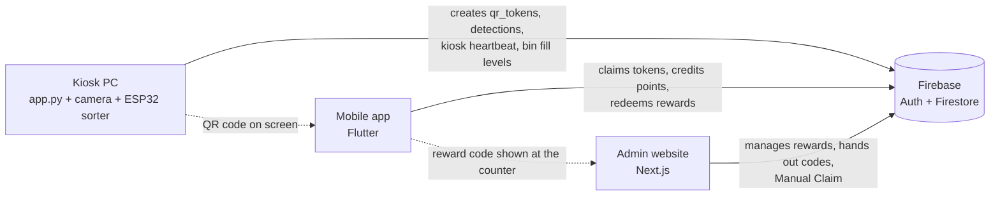

# ECOReward Bin: kiosk, security rules and ESP32 firmware

The smart bin that sorts café waste and turns each correct deposit into a QR code worth points. This repository also holds the Firestore security rules and the ESP32 firmware for the whole ECOReward system.

## The ECOReward system

ECOReward Bin rewards café customers for sorting their waste. The system has three projects, and all of them
share one Firebase project, `ecoreward-bin` (Authentication and Cloud Firestore):

| Project | Repository | Built with | Who uses it |
|---|---|---|---|
| **Kiosk** (the smart bin) | [App.py---CASPTONE](https://github.com/JmMoshi16/App.py---CASPTONE) | Python 3.11, YOLOv8, OpenCV, ESP32 | Customers at the bin |
| **Mobile app** | [CAPSTONE-1](https://github.com/JmMoshi16/CAPSTONE-1) | Flutter (Android, iOS) | Customers, plus staff with an admin account |
| **Admin website** | [CAPSTONE-1-WEB](https://github.com/JmMoshi16/CAPSTONE-1-WEB), live at capstone-2-web.vercel.app | Next.js 14, Tailwind | Café staff at the counter |

The projects never call each other directly. Each one reads and writes Firestore, and the Firestore security
rules decide what each one may do.



### A customer's journey

1. **Deposit.** The customer drops one item onto the kiosk tray. The camera and the YOLO model identify it, the
   scale weighs it, and the ESP32 tips it into the right bin (Biodegradable, Recyclable or Residual).
2. **QR code.** Only after the ESP32 confirms the drop does the kiosk save a one-time token to `qr_tokens`. It
   then shows the QR code `ECOBIN:<wasteType>:<token>`, valid for 20 minutes.
3. **Earn.** The customer scans the QR code with the app. The app claims the token and credits points, with a
   streak bonus and any badge bonus. It writes `waste_logs` and `qr_scan_history`. The kiosk sees the claim and
   shows "Claimed!".
4. **No phone?** The kiosk shows a claim code (`ECO-1234`) instead. Staff enter it on the website's **Manual
   Claim** page with the customer's username, and the customer is credited exactly like a phone scan.
5. **Redeem.** In the app the customer redeems a Crave menu item. The points are taken off and an 8-character
   code is created, valid for 7 days.
6. **Hand out.** At the counter, staff type the code on the website (**Rewards & Redemptions → Redemptions**). The
   site says whether it is valid, already handed out, expired or unknown. Staff click **Mark as Claimed**, and the
   customer's app shows "Handed out" within a second.

### Firestore collections

| Collection | Written by | Read by |
|---|---|---|
| `users` | app (sign-up, scan, redeem); website Manual Claim | the owner; admins |
| `profiles` | app and website, always an exact copy of the public fields of `users` | every signed-in user (leaderboard) |
| `qr_tokens` | kiosk (creates); app (claims); website Manual Claim; staff in the app (manual QR) | app, kiosk, website |
| `waste_logs` | app (each scan); website Manual Claim | the owner; admins |
| `qr_scan_history` | app (each scan) | admins (website Scan History) |
| `rewards` | admins (website and app); a redeem lowers `stock` by 1 | everyone signed in |
| `redemptions` | app (redeem); admins mark them `claimed` | the owner; admins |
| `detections` | kiosk (one per issued code, with the model file and its SHA-256) | admins, in the Firebase console |
| `kiosks`, `bins` | kiosk (heartbeat, fill levels) | admins (website Bin Management) |

### Shared business rules

Each project keeps a copy of the same `rules.json`: the kiosk in `config/rules.json`, the app in
`assets/config/rules.json`, the website in `config/rules.json`. The kiosk's `ConfigParityTest` fails if the copies
disagree, so change all three together.

| Rule | Value |
|---|---|
| Points per item | Biodegradable 15 · Recyclable 10 · Residual 5 |
| Streak multiplier (days in a row with a scan) | 1–2 days ×1 · 3–6 days ×1.5 · 7+ days ×2 |
| Compact bonus | +5 for a crushed can, bottle or cup, added after the streak multiplier. The kiosk judges it by how small the item looks on the tray (`compactBonus` in `rules.json`) and writes it on the token as `bonusPoints` |
| QR code validity / reward code validity | 20 minutes / 7 days |
| Ranks (lifetime points) | Bronze 0 · Silver 50 · Gold 200 · Platinum 500 |
| Levels (lifetime points) | Seedling 0 · Sprout 100 · Grower 250 · Warrior 500 · Champion 1000 · Legend 2000 |
| Badges (one-time bonus when unlocked) | First Scan +5 · 5 Scans +10 · Eco Starter (10 scans) +15 · Eco Warrior (25) +20 · Eco Champion (50) +25 · Point Earner (50 pts) +5 · Century Club (100 pts) +10 · Platinum Eco (500 pts) +20 · On a Roll (3-day streak) +10 · Week Warrior (7-day streak) +20 |

Spending points lowers the balance only. Rank, level and the leaderboard use **lifetime** points, so redeeming
never demotes anyone.

### Security in one paragraph

All access goes through the Firestore rules in the kiosk repository (`firebase/firestore.rules`, 101 emulator
tests). They stop customers from making themselves admin, reading other customers' e-mails, adding more than +100
points in one write, claiming a QR code twice, or creating a reward code without paying for it. Admins are
accounts whose `users/{uid}.role` is `admin` (or that have the `admin` custom claim). The kiosk uses its own
limited identity (`kiosk: true`). **Known limit:** the phone credits points itself, so the rules can only bound
each write. The real fix is a Cloud Function that credits points on the server (Blaze plan).
**Status:** the rules in the repository are **not deployed yet**. Deploy steps are in the kiosk README.

---

## This project: the kiosk

`app.py` runs on the PC inside the bin. It drives the touch screen, reads the camera, runs the YOLO model, talks to
the ESP32 over USB serial, and writes to Firestore. It never writes `users`, `waste_logs`, `redemptions` or
`profiles`: crediting points is done by the app and the website. This repository also holds the **Firestore
security rules** and the **ESP32 firmware** used by the whole system.

### Folder map

```
app.py                  entry point: camera, model, Firestore, main loop
kiosk/                  config.py (settings) · hardware.py (ESP32 link, simulator) · flow.py (deposit state machine)
kiosk/ui/               design tokens, drawing, icons, components and screens of the kiosk UI
kiosk_firestore.py      least-privilege Firestore client used with the kiosk identity
config/                 rules.json (shared rules) · waste_map.json (model label → category) · kiosk_settings.json
firebase/               firestore.rules · firebase.json · tests/ (rules tests, Node)
firmware/               ESP32 sketches (flash ecoreward_bin_360 for hold mode)
tools/                  admin and maintenance scripts (below)
tests/                  Python tests (fakes; no camera, model, Firebase or ESP32 needed)
assets/fonts/           DM Sans + Fraunces (same as the app)
best.pt                 the trained model: NOT in git (get it from the team)
```

### Set up the kiosk PC

1. **Python 3.11** (PyTorch does not support 3.14) and the
   [Visual C++ Redistributable](https://aka.ms/vs/17/release/vc_redist.x64.exe).
2. Install the packages:
   ```bash
   py -3.11 -m pip install torch torchvision --index-url https://download.pytorch.org/whl/cpu
   py -3.11 -m pip install -r requirements.txt
   ```
3. Put `best.pt` next to `app.py`.
4. Connect to Firebase with the **kiosk identity** (recommended; needs the rules deployed first):
   - On an admin's computer: `py -3.11 tools\set_claims.py create-kiosk --name cafe-kiosk-1 --api-key <Web API key>`.
     This writes `%USERPROFILE%\.ecoreward\kiosk.json`. It holds a public API key and a revocable sign-in token,
     no password and no private key.
   - Copy `kiosk.json` to `C:\Users\<kiosk user>\.ecoreward\` on the kiosk PC, or point `ECOREWARD_KIOSK_CONFIG` at it.
   - The kiosk may then only create well-formed QR tokens, read a token, write its own heartbeat and fill
     levels, and add detections. It cannot read customers.
   - Lost or retired kiosk: `py -3.11 tools\set_claims.py revoke-kiosk cafe-kiosk-1`.
5. **Admin key, legacy mode.** The tools in `tools/` use a service-account key. It bypasses every rule, so keep
   it on an admin's computer **outside this folder**: `~/.ecoreward/kiosk-sa.json` or `GOOGLE_APPLICATION_CREDENTIALS`.
   - Without `kiosk.json` the kiosk falls back to this key and prints a `[SECURITY]` warning.
   - Never commit, zip or share the key. If it ever left a safe place, create a new key and delete the old key ID
     in Google Cloud.
   - Lookup order: `ECOREWARD_KIOSK_CONFIG` / `~/.ecoreward/kiosk.json` → `GOOGLE_APPLICATION_CREDENTIALS` →
     `~/.ecoreward/kiosk-sa.json` → (deprecated) `serviceAccountKey.json[.json]` next to `app.py`.
   - With no credential at all the kiosk runs **offline**: it sorts items but issues no QR codes.

### Run it

```bash
py -3.11 app.py                              # the real bin (hold mode): ESP32 on COM3, full screen
py -3.11 app.py --mode esp32                 # the older tray bin (the load cell starts a deposit, a servo tips the tray)
py -3.11 app.py --no-hardware --windowed     # same flow with a simulated ESP32 (shows SIMULATION; press I to drop an item)
py -3.11 app.py --mode camera --windowed     # testing without hardware: the camera sees the item leave
py -3.11 app.py --mode attendant --windowed  # testing without hardware: staff press SPACE
py -3.11 app.py --help                       # every option
```

Settings live in `config/kiosk_settings.json` (no secrets); command-line flags override them. Important ones:
`serial_port` (`COM3`), `camera_index` (0), `min_item_g` (6 g), `steady_ms` (500), `identify_timeout_s` (3),
`ok_timeout_s` (15: the chute may need up to 12 s to reach a bin), `drop_timeout_s` (12), `tray_roi` (the part of the camera image showing the tray),
`auto_tare_idle_s` (20), `identify_s` (5: seconds the camera looks at the item before deciding).

**`pretend_weight` (on for now):** the load cell is not part of the demo. The camera starts the deposit (an item
in view for 3 frames, after the tray was seen empty for 10), the weight on screen is made up (8–30 g), the
too-heavy check is skipped, and an `ERR:HX711` doesn't take the kiosk out of service. Set it to `false` once the
scale is fitted; everything else in the flow stays the same.

**Staff keys:** `D` diagnostics (weight, state, serial lines, fill levels, camera with the tray rectangle) ·
`H` session history · `R` claim-code receipt · `C` back to Ready after clearing a jam · `I` simulated item ·
`SPACE` attendant confirm · `Esc` close overlay · `Q` quit. Customers only use the touch buttons (**No phone? Claim
code**, **Done**, **OK**), each at least 80 px tall.

### How a deposit works (hold mode, the default)

The bin has no tray. The customer holds the item in the bin opening under the camera, and the ESP32's load cell
sits under a small **drop plate**: the item falls onto it and slides into the chute. No reward code can exist
before the ESP32 reports that bump (`DONE`).

1. **Ready:** "Hold your item still inside the bin for 3 seconds, then let go when we say so." A deposit can only
   start while the ESP32 is connected ("The bin is reconnecting" otherwise), the kiosk is online, the cooldown
   (`cooldown_seconds`) has passed, and the last item has left the view.
2. **Hold still** (`hold_min_s` 3 s, progress bar): one item, still. A jump of more than a quarter of its size
   between frames, or leaving the view (3 empty frames), restarts the count. After 3 s it locks if one label has
   at least 60 % of the frames since the hold started and maps to a category (YOLO confidence ≥ 0.30,
   `config/waste_map.json`). No clear label by `hold_max_s` (5 s): "We couldn't recognise this item", no code,
   and the item must leave the view before a new try.
3. **Turn the chute:** the kiosk sends `1` / `2` / `3` (`bin_codes`) and shows "Keep holding: turning to the …
   bin". It needs `OK:<n>` for that bin within `ok_timeout_s` (15 s); an `OK` for another bin is ignored.
4. **Let go:** "Let go of the item – the chute is at the … bin" with a `drop_timeout` (15 s) countdown. The camera
   does not count the drop here; only the scale does.
5. **Drop proof:** `DONE:<n>:<grams>` for the same bin. The grams are saved on the transaction, then the token is
   created and the QR code and **No phone? Claim code** appear as in every mode.
6. **Failures, never a code:** no `OK` in time, `JAM`, `ERR` or a lost serial link → "The bin couldn't get ready";
   `NODROP` or no `DONE` in time → "We didn't see it go in".

### How a deposit works (tray mode, `--mode esp32`)

No reward code can exist before the ESP32 reports that the item left the tray.

1. **Ready:** "Drop one item into the slot". The kiosk watches the weight; YOLO is not running yet.
2. **Weighing:** an item counts once the weight is above `min_item_g` and steady within 1 g for 500 ms.
3. **Identifying:** YOLO runs on the tray crop. A box needs confidence ≥ 0.30, the label is decided by a majority
   of the frames seen during `identify_s` (5 s), and the step ends after 5 s even if the camera is slow. `config/waste_map.json` maps the label to a category.
4. **Decide.** Rejected items still go to **Residual**, without a code:
   - the item isn't recognised;
   - it is heavier than `max_weight_g` for its label (for example a cup with drink left);
   - more than one item is on the tray.
5. **Sorting:** the kiosk sends `1`, `2` or `3` and needs `OK:n`, then `DONE:n:grams`. A `JAM` or a timeout shows
   **Item stuck**: staff clear the tray and press `C`.
6. **Reward:** the token is saved in the background, and the QR code appears only after the save succeeded. Items
   that earn nothing show "Thank you". If Firebase is offline the kiosk says so and shows no code.
7. Back to Ready when the scale reads empty.

**Compact bonus.** In step 3 the kiosk also measures how much of the tray the item's box covers. If a can, bottle or
cup covers no more than its limit in `rules.json` → `compactBonus.maxBoxFrac`, it counts as crushed. The middle value
of the frames decides, so one odd frame can't. The token then gets `bonusPoints: 5`, and the QR screen says
"Includes +5 compact bonus". The limits are starting values. To calibrate them:
1. Drop a normal item and a crushed one a few times each.
2. Read **Last item → Size** on the **D** screen.
3. Set the limit halfway between the two, in all three `rules.json` copies.

**Bins and faults:**
- **Fill levels:** the ESP32 reports them after every drop and the kiosk writes them to `bins/{kioskId}-bio|rec|res`.
  At 90 % a banner appears; at 100 % the kiosk pauses until the bin is emptied.
- **ESP32 silent:** the kiosk shows **Out of service** and reconnects by itself.
- **Logs:** everything goes to `logs/kiosk.log`, one file per day, kept 14 days.

### Kiosk screen design

The exact values live in code: `kiosk/ui/theme.py` (colours, type, spacing, motion), `draw.py` (primitives),
`components.py` and `screens.py`.

- **One job per screen:** each screen answers *what is happening?* and *what do I do next?* Diagnostics and
  history sit behind staff keys.
- **Honest states:** the kiosk shows only stages the hardware really performs, and labels simulation on every
  frame. It says a code was *claimed*, never that points were *credited*, because the app does that.
- **Layout:**
  - drawn on a 1280×720 grid and scaled to the display (7" 1024×600 up to 1920×1080);
  - a top bar with the wordmark, status chips (Online / Sorter / Camera) and the time;
  - a large state card on the left (Ready, Checking, Sorting into…, Rejected, Item stuck, Bin full, Out of
    service);
  - a stage panel on the right with the weight, the category and a stepper (Weigh → Recognise → Sort → Code);
  - full-screen moments (success, receipt) as a card over a dimmed background.
- **Look and readability:**
  - Crave navy and yellow on cream, the same as the app;
  - Fraunces for headlines and DM Sans for text, from `assets/fonts/`;
  - body text 18 px or larger, nothing under 13 px;
  - text contrast at least 4.5:1 (tested);
  - colour never used alone: categories always show an icon and a word.
- **Touch and motion:**
  - buttons are at least 80 px tall;
  - the QR code has a quiet zone, is at least 300 px at 720p and is never blurred by scaling;
  - motion only explains a change of state (160–600 ms), and `"reduce_motion": true` turns it off.
- **Copy:** second person and plain verbs. Errors say what happened to the item and what to do next.

### ESP32 protocol and firmware

ASCII lines at 115200 baud, implemented in `kiosk/hardware.py` and `firmware/ecoreward_bin_360/` (hold mode).
Lines starting with `#` are the firmware's debug messages; the kiosk ignores them.

| Direction | Line | Meaning |
|---|---|---|
| kiosk → ESP32 | `1` / `2` / `3` | sort into Biodegradable / Recyclable / Residual (`bin_codes` in `rules.json`) |
| kiosk → ESP32 | `T` / `P` | tare the scale / ping |
| ESP32 → kiosk | `READY` | booted, chute at home |
| ESP32 → kiosk | `W:<grams>` | weight, 5 times a second |
| ESP32 → kiosk | `OK:<n>` then `DONE:<n>:<grams>` | chute at bin n; the item landed on the drop plate (peak grams). Tray mode: the item left the tray |
| ESP32 → kiosk | `NODROP:<n>` | hold mode: nothing landed on the plate within 15 s of `OK` |
| ESP32 → kiosk | `JAM:<n>` | the chute's switch never clicked (12 s), or the item stayed on the plate over 3 s (tray mode: still on the tray after tipping twice) |
| ESP32 → kiosk | `FILL:<b>,<r>,<s>` | fill % of the 3 bins (`-1` = no reading) |
| ESP32 → kiosk | `PONG` / `ERR:<text>` | answer to `P` / a fault (e.g. `ERR:HX711 not found`) |

**Firmware** (`firmware/`): flash `ecoreward_bin_360` (board: ESP32 Dev Module; libraries: HX711 by bogde
0.7.5, ESP32Servo). It has `HAS_TRAY = false`: only the 360° chute servo (P18) and the drop-plate scale are used.
Test it without the kiosk in the Serial Monitor: `TEST2`, wait for `OK:2`, drop something on the plate, and
`DONE:2:<grams>` follows. Other setup commands: `SW`, `STATUS`, `SPIN+`, `SPIN0`, `GO1`–`GO3`, `FLIP`,
`SET STOP|SPEED|CREEP`, `K100`, `SAVE`, `RESET`. `ecoreward_bin_perfboard` (tray), `ecoreward_bin` (old single
servo) and `servo_test` are the older sketches.

| Part | Pin / value |
|---|---|
| HX711 load cell | DT GPIO 16, SCK GPIO 4; factor 2280 (`K<grams>` to calibrate, `SAVE` to keep) |
| Chute servo | 360° on GPIO 18; always turns forward to the chosen bin's end switch (Bio P13, Rec P17, Res P21) |
| Tray servo | none in hold mode (`HAS_TRAY = false`) |
| 3 × HC-SR04 fill sensors | TRIG GPIO 25/26/27, ECHO GPIO 32/33/34; 30 cm empty, 5 cm full |

Power the servos from their own 5 V supply and tie the grounds together. The HC-SR04 ECHO is 5 V: use a divider
(1 kΩ / 2 kΩ) to bring it down to 3.3 V. To upload, close the kiosk and Arduino's Serial Monitor first, because
both hold COM3.

### The model

`best.pt` is a YOLOv8n detector with 20 classes, imgsz 640 and 100 epochs, trained on Kaggle on 2026-09-08
(SHA-256 `0003698731bd…dce5a`).
- **Validation scores:** precision 0.747, recall 0.761, mAP@50 0.776, mAP@50-95 0.613. They come from the
  training split, **not** from the kiosk camera.
- **Classes:** every one must be in `config/waste_map.json`, or the kiosk refuses to issue codes.
- **Label problems to fix before retraining:**
  - a stray class `1`;
  - duplicates: `Paper cup`/`paper-cup`, `Spoon`/`spoon`, `TISSUE`/`tissue`.
- **Measuring on the kiosk:** collect at least 30 kiosk-camera photos per category, then run
  `tools/eval_model.py --set <photos>`.
- **Speed:** about 22 FPS on the development PC. An optional OpenVINO export is loaded automatically when
  `best_openvino_model/` exists.
- `train.py` is a legacy script that did **not** produce this model.

### Firestore rules (`firebase/`)

`firebase/firestore.rules` protects every collection in the table above. The tests in `firebase/tests/rules.test.mjs`
(101 cases) replay the real operations of the app, the website and the kiosk, including attacks: self-promotion to
admin, reading e-mails, double claims, free rewards, and a stolen kiosk identity. Run them on the local emulator,
never against the real project:

```powershell
$env:JAVA_HOME = "C:\Program Files\Android\Android Studio\jbr"; $env:Path = "$env:JAVA_HOME\bin;$env:Path"
cd firebase\tests; npm install; npm test
```

**Deploy (not done yet). In this order:**
1. Back up the live rules (Firebase console → Firestore → Rules → copy).
2. Install the current app on every phone. Redeeming now has to be paid in the same write and dated by the
   server, which older app builds don't do.
3. Run `py -3.11 tools\backfill_profiles.py` so the leaderboard has every customer.
4. Check that admins have `role: "admin"`.
5. Deploy the rules and the indexes from the `firebase/` folder: `firebase use ecoreward-bin`, then
   `firebase deploy --only firestore`. `firebase.json` points at both `firestore.rules` and `../firestore.indexes.json`.
   Without the indexes, the leaderboard and customer-history queries fail.
6. Try a scan, a redeem and a hand-out on the live project. Keep the backup to roll back.

### Admin and maintenance tools (`tools/`, use the admin key)

| Tool | What it does |
|---|---|
| `set_claims.py` | create or revoke the kiosk identity; grant the `admin` claim |
| `backfill_profiles.py` | create the public `profiles` copy for older accounts |
| `delete_user_data.py <email>` | erase one customer's account and data on request (dry run first, then `--apply`) |
| `migrate_timestamps.py` | convert old ISO-string dates to Timestamps (date queries skip strings) |
| `eval_model.py` | score the model on a labelled kiosk-camera photo set |
| `bench_kiosk.py` | measure inference and drawing speed |
| `break_restore.py` | re-introduce past critical bugs in temporary copies; each must make a test fail |

### Tests

```bash
py -3.11 -I -m unittest discover -s tests -v     # 132 tests; fakes replace camera, model, Firebase and the ESP32
```
They run the real main loop:
- simulated deposits, jams and an unplugged ESP32;
- every screen at three resolutions;
- the QR code decoded back to its exact payload;
- contrast and touch-target sizes;
- the token contract, and rule parity with the app and the website.

GitHub Actions runs them, together with a secret scan (gitleaks), in `.github/workflows/`.

### Privacy

- **Camera:** images are processed on the kiosk and never saved or uploaded. Only the result (label, category,
  confidence) is stored in `detections`.
- **Customer data:** e-mail, username, an optional photo, scans and redemptions. The leaderboard shows only the
  username, points and badges.
- **Deleting an account:** staff run `tools/delete_user_data.py`.
- **Before real customers use it:** a privacy notice in plain words must be published, with the café's contact
  e-mail, under the Philippine Data Privacy Act of 2012.

### Known limits

- The phone credits points itself (see Security above). A stolen kiosk identity could create tokens until it is
  revoked.
- If the network is down when the kiosk starts, it stays offline until it is restarted.
- There is no autostart or watchdog yet; `Q` or the window's close button quits the kiosk.
- The model's accuracy on the real kiosk camera has not been measured.
